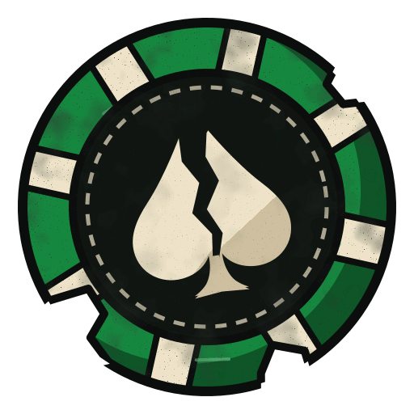

<p align="center">
  
  <h1 align="center">@bustit/shared</h1>
</p>
<p align="center">
  Schemas and types shared between the game server and the web app.
</p>
<p align="center">
  
  
</p>

## Table of Contents

- [Introduction](#introduction)
- [Development](#development)

## Introduction

The shared package holds the contract between the game server and the web app: Zod schemas for the
requests and responses of the API, the types inferred from them, and the input rules both sides
apply, such as what makes a valid username or password.

The server validates incoming requests with these schemas. The web app builds its forms on the same
rules with messages of its own, so a rule is defined once and both sides agree on it.

## Development

Builds the package to `dist/`, where the server and the web app consume it from.

```bash
npm run build -w @bustit/shared
```

Runs the tests of the schemas.

```bash
npm run test -w @bustit/shared
```
